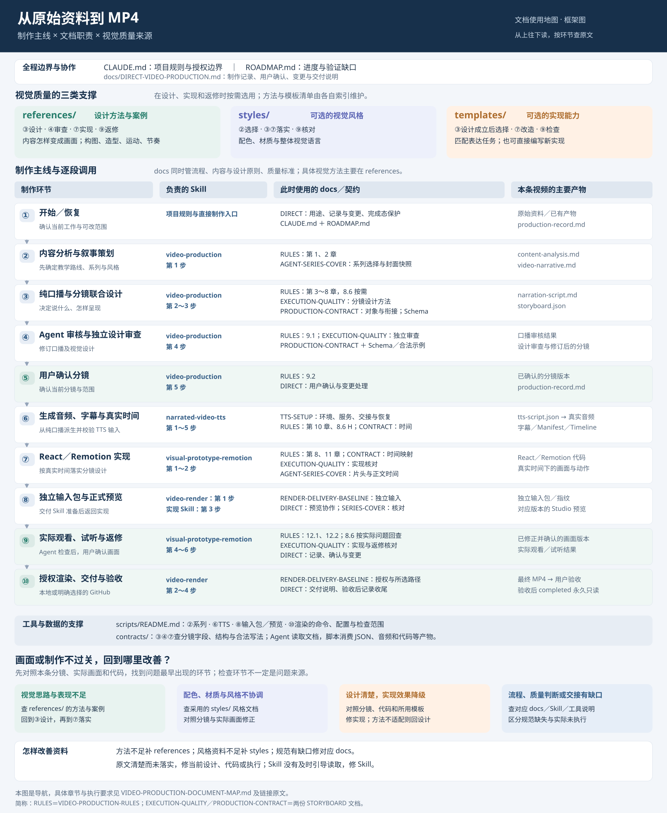

# 从原始资料到 MP4：文档使用地图

## 框架总览图

先看制作主线、Skill、规范与产物的对应关系，再按下文定位具体章节。上方三类视觉资料按标注环节介入，底部说明质量问题的回查方向；设计与返修可以往返。



[打开矢量图，可放大查看](VIDEO-PRODUCTION-FRAMEWORK.svg)。图中简称及具体章节以本文和原文为准。

## 用途与读法

本文用于三件事：先了解各类文档负责什么，再按制作环节查「现在用哪份文档的哪一节」，出现问题时判断应回到流程、内容、视觉设计、风格还是实现资料。每张环节表按文件、具体部分、实际作用和排查对象逐项对应。本文是导航；执行规则仍以链接指向的原文为准，工具命令只在 [scripts/README.md](../scripts/README.md) 维护。

这里的「使用文档」指 Agent 在工作位置读取并落实要求，不表示脚本会自动读取这些 Markdown。脚本实际消费的是口播、JSON、音频、配置及代码等产物；读取规范、调用工具、检查结果是不同动作。

每次先定位当前环节，再读该环节列出的必读内容；「按需」项只在对应问题出现时展开。恢复制作时根据本条视频的制作记录及实际产物重新定位，不靠一次性通读后的记忆。下列编号用于查阅，可以在策划、设计、实现和返修之间往返，不增加生产阶段或阅读打卡。

## 各类文档负责什么

下面先按职责区分，再在后文按制作顺序定位。职责之间会有交叉：`docs/` 除流程外也规定内容、设计原则与质量标准；视觉设计的具体方法和案例主要由 `references/` 提供。

| 文件或目录 | 在什么时候起作用 | 主要解决什么问题 |
|---|---|---|
| [CLAUDE.md](../CLAUDE.md)、[ROADMAP.md](../ROADMAP.md) | 开始／恢复制作，确认边界与当前能力时 | 项目规则、授权边界、当前进度及待验证能力 |
| `docs/` 中的各篇规范 | 从策划到交付，按当前任务查对应篇章 | 流程和确认、内容与设计原则、质量标准、分镜关联与时间、TTS 环境及渲染交付；各篇职责见「按文件反查」 |
| `.claude/skills/` 中的四份制作 Skill | 进入各自阶段及交接时 | 指导 Agent 做哪些工作、何时读相关资料、怎样检查和交接；具体分工见下方 Skill 表 |
| [references/](../references/README.md) | 分镜设计、画面实现和视觉返修 | 将内容变成可见过程，提供构图、字体、造型、配色与空间、运动、镜头、转场及全片节奏的方法与案例 |
| `styles/` 中的风格文档 | 策划选择风格，分镜与实现落实，观看时核对 | 提供可选的配色、材质和整体视觉语言，帮助保持风格协调；不决定所有画面的构图和动作 |
| [templates/](../templates/README.md) | 设计方案成立后选择实现，改造后检查效果 | 提供可选、可改造的 React／Remotion 实现；是否匹配取决于表达任务与对象关系，没有匹配项时自行编写 |
| `contracts/video-production/current/` 中的 Schema 与示例 | 编写、核对分镜以及实现读取分镜时 | 定义字段、结构及合法写法；结构合法不能证明视觉设计成立 |
| [scripts/README.md](../scripts/README.md) | 系列处理、TTS、输入包、预览、渲染及工具排障 | 说明命令、配置、输入输出与检查覆盖；工具执行成功不能证明画面质量合格 |
| 当前视频的资料、分镜与实现代码 | 各阶段生成、消费和返修时 | 保存本条视频实际采用的内容与设计，把公共方法落实为具体画面，是排查质量问题时要同时核对的对象 |

画面不过关时，先判断缺的是设计思路、风格协调还是实现效果：设计方法主要回到 `references/`，风格回到 `styles/`，设计如何组织和质量如何判断回到对应 `docs/`；已经设计清楚却没有实现的部分，则对照分镜修代码或所用模板。流程顺利、字段合法和工具成功都不能单独保证视觉质量。

本文维护目录职责、稳定规范及使用环节；`references/` 的具体方法、案例和技法由其自身索引维护，不在此复制完整清单或逐篇追踪章节变化。`templates/` 的具体模板同样以自身索引和选中模板说明为准。

## 全程路线

```text
原始资料
  → ① 开始／恢复与范围核对
  → ② 内容分析、叙事策划、系列选择
  → ③ 纯口播与分镜联合设计
  → ④ Agent 口播审核、独立设计审查、修订
  → ⑤ 用户确认分镜
  → ⑥ TTS 输入 → 真实音频、字幕、Timeline
  → ⑦ 真实时间映射与 React／Remotion 实现
  → ⑧ 独立输入包与正式预览
  → ⑨ Agent 完整观看／试听、返修 → 用户确认画面
  → ⑩ 明确授权当前输入渲染 → 本地或 GitHub → MP4 → 用户验收
```

四份 Skill 的交接关系：

| Skill | 负责的工作 | 交接位置 |
|---|---|---|
| [video-production](../.claude/skills/video-production/SKILL.md) | 策划、口播、分镜、提交前审查与分镜确认 | 分镜确认后交给 TTS Skill |
| [narrated-video-tts](../.claude/skills/narrated-video-tts/SKILL.md) | 派生 TTS 输入、调用生成脚本、核对真实音频／字幕／Timeline | 真实时间资料就绪后交给实现 Skill |
| [visual-prototype-remotion](../.claude/skills/visual-prototype-remotion/SKILL.md) | 正式 Remotion 实现、观看试听、返修及用户画面确认 | 中途调用交付 Skill 准备预览；画面确认并获渲染授权后交给交付 Skill |
| [video-render](../.claude/skills/video-render/SKILL.md) | 独立输入包、Studio 预览、本地或 GitHub 交付与恢复 | 准备预览后返回实现 Skill；正式交付后交用户验收 |

Skill 文件当前均较短，进入环节时读取整份；下面用步骤名称或编号定位其中的实际工作。

## ① 开始或恢复：确定正在做什么、可以改什么

**输入**：用户任务、原始资料；恢复时还包括已有制作记录、代码和媒体。

<table style="width: 100%; table-layout: fixed;">
<colgroup><col width="25%"><col width="25%"><col width="25%"><col width="25%"></colgroup>
<thead>
<tr>
<th width="25%" style="vertical-align: top; white-space: normal; overflow-wrap: anywhere; word-break: normal;">使用文件</th>
<th width="25%" style="vertical-align: top; white-space: normal; overflow-wrap: anywhere; word-break: normal;">具体部分</th>
<th width="25%" style="vertical-align: top; white-space: normal; overflow-wrap: anywhere; word-break: normal;">此时用它做什么</th>
<th width="25%" style="vertical-align: top; white-space: normal; overflow-wrap: anywhere; word-break: normal;">出现问题时对照什么</th>
</tr>
</thead>
<tbody>
<tr>
<td style="vertical-align: top; white-space: normal; overflow-wrap: anywhere; word-break: normal;"><code style="white-space: normal; overflow-wrap: anywhere;">~/.claude/CLAUDE.md</code></td>
<td style="vertical-align: top; white-space: normal; overflow-wrap: anywhere; word-break: normal;">「动手前确认」「工具使用约束」「红线操作」</td>
<td style="vertical-align: top; white-space: normal; overflow-wrap: anywhere; word-break: normal;">核对任务和操作授权</td>
<td style="vertical-align: top; white-space: normal; overflow-wrap: anywhere; word-break: normal;">是否越过讨论范围或执行未授权操作</td>
</tr>
<tr>
<td style="vertical-align: top; white-space: normal; overflow-wrap: anywhere; word-break: normal;"><a href="../CLAUDE.md" style="overflow-wrap: anywhere;">CLAUDE.md</a></td>
<td style="vertical-align: top; white-space: normal; overflow-wrap: anywhere; word-break: normal;">「项目定位」「规则与 Skill 路由」「仓库边界」「项目底线」</td>
<td style="vertical-align: top; white-space: normal; overflow-wrap: anywhere; word-break: normal;">确定项目流程、存放位置及规则入口</td>
<td style="vertical-align: top; white-space: normal; overflow-wrap: anywhere; word-break: normal;">是否走错流程、写错位置或修改完成态视频</td>
</tr>
<tr>
<td style="vertical-align: top; white-space: normal; overflow-wrap: anywhere; word-break: normal;"><a href="../ROADMAP.md" style="overflow-wrap: anywhere;">ROADMAP.md</a></td>
<td style="vertical-align: top; white-space: normal; overflow-wrap: anywhere; word-break: normal;">「当前阶段」「进行中」「阻塞与待承接资料」「最近验证」</td>
<td style="vertical-align: top; white-space: normal; overflow-wrap: anywhere; word-break: normal;">核对工具实际能力与未验范围</td>
<td style="vertical-align: top; white-space: normal; overflow-wrap: anywhere; word-break: normal;">是否把尚未接入或尚未验证的能力当作已可用</td>
</tr>
<tr>
<td style="vertical-align: top; white-space: normal; overflow-wrap: anywhere; word-break: normal;"><a href="DIRECT-VIDEO-PRODUCTION.md" style="overflow-wrap: anywhere;">DIRECT-VIDEO-PRODUCTION.md</a></td>
<td style="vertical-align: top; white-space: normal; overflow-wrap: anywhere; word-break: normal;">「文档用途与使用方法」「制作记录、用户确认与变更处理」「完成态保护与已有资料使用」</td>
<td style="vertical-align: top; white-space: normal; overflow-wrap: anywhere; word-break: normal;">定位新建／恢复工作及允许修改的范围</td>
<td style="vertical-align: top; white-space: normal; overflow-wrap: anywhere; word-break: normal;">当前版本、原确认和复用范围是否判断正确</td>
</tr>
<tr>
<td style="vertical-align: top; white-space: normal; overflow-wrap: anywhere; word-break: normal;"><code style="white-space: normal; overflow-wrap: anywhere;">videos/&lt;slug&gt;/production-record.md</code>；存在时只读核对 <code style="white-space: normal; overflow-wrap: anywhere;">harness/projects/&lt;slug&gt;/state.json</code></td>
<td style="vertical-align: top; white-space: normal; overflow-wrap: anywhere; word-break: normal;">当前工作、确认范围、问题与未验事项、完成状态</td>
<td style="vertical-align: top; white-space: normal; overflow-wrap: anywhere; word-break: normal;">根据本条视频事实定位进度</td>
<td style="vertical-align: top; white-space: normal; overflow-wrap: anywhere; word-break: normal;">记录是否对应实际产物，是否遗漏已有确认或完成标记</td>
</tr>
</tbody>
</table>

**输出与去向**：确定本次工作位置及范围；新视频沿用直接制作入口建立一份制作记录，然后进入策划。恢复视频从实际缺口进入后续对应环节，无需机械重走全部步骤。

## ② 内容分析与叙事策划：把资料变成教学路线

**输入**：用户提供的文章、文档、示例及其他原始资料。

<table style="width: 100%; table-layout: fixed;">
<colgroup><col width="25%"><col width="25%"><col width="25%"><col width="25%"></colgroup>
<thead>
<tr>
<th width="25%" style="vertical-align: top; white-space: normal; overflow-wrap: anywhere; word-break: normal;">使用文件</th>
<th width="25%" style="vertical-align: top; white-space: normal; overflow-wrap: anywhere; word-break: normal;">具体部分</th>
<th width="25%" style="vertical-align: top; white-space: normal; overflow-wrap: anywhere; word-break: normal;">此时用它做什么</th>
<th width="25%" style="vertical-align: top; white-space: normal; overflow-wrap: anywhere; word-break: normal;">出现问题时对照什么</th>
</tr>
</thead>
<tbody>
<tr>
<td style="vertical-align: top; white-space: normal; overflow-wrap: anywhere; word-break: normal;"><a href="../.claude/skills/video-production/SKILL.md" style="overflow-wrap: anywhere;">.claude/skills/video-production/SKILL.md</a></td>
<td style="vertical-align: top; white-space: normal; overflow-wrap: anywhere; word-break: normal;">第 1 步「策划」</td>
<td style="vertical-align: top; white-space: normal; overflow-wrap: anywhere; word-break: normal;">保存来源，完成内容分析、叙事安排与内部检查</td>
<td style="vertical-align: top; white-space: normal; overflow-wrap: anywhere; word-break: normal;">是否跳过策划或用不完整资料直接写分镜</td>
</tr>
<tr>
<td style="vertical-align: top; white-space: normal; overflow-wrap: anywhere; word-break: normal;"><a href="VIDEO-PRODUCTION-RULES.md#1-核心目标" style="overflow-wrap: anywhere;">VIDEO-PRODUCTION-RULES.md</a></td>
<td style="vertical-align: top; white-space: normal; overflow-wrap: anywhere; word-break: normal;">第 1 章「核心目标」、2.1「先提取知识，再设计视频」</td>
<td style="vertical-align: top; white-space: normal; overflow-wrap: anywhere; word-break: normal;">确定受众、学习目标与知识取舍</td>
<td style="vertical-align: top; white-space: normal; overflow-wrap: anywhere; word-break: normal;"><code style="white-space: normal; overflow-wrap: anywhere;">content-analysis.md</code> 是否遗漏关键前提、因果或知识点</td>
</tr>
<tr>
<td style="vertical-align: top; white-space: normal; overflow-wrap: anywhere; word-break: normal;"><a href="VIDEO-PRODUCTION-RULES.md#22-video-narrative-独立于文章结构" style="overflow-wrap: anywhere;">VIDEO-PRODUCTION-RULES.md</a></td>
<td style="vertical-align: top; white-space: normal; overflow-wrap: anywhere; word-break: normal;">2.2「Video Narrative 独立于文章结构」</td>
<td style="vertical-align: top; white-space: normal; overflow-wrap: anywhere; word-break: normal;">重组讲解顺序，确定教学完整性与风格</td>
<td style="vertical-align: top; white-space: normal; overflow-wrap: anywhere; word-break: normal;"><code style="white-space: normal; overflow-wrap: anywhere;">video-narrative.md</code> 是否照搬文章、缺少操作输入或结果核对</td>
</tr>
<tr>
<td style="vertical-align: top; white-space: normal; overflow-wrap: anywhere; word-break: normal;"><a href="AGENT-SERIES-COVER.md#系列选择与封面快照" style="overflow-wrap: anywhere;">AGENT-SERIES-COVER.md</a></td>
<td style="vertical-align: top; white-space: normal; overflow-wrap: anywhere; word-break: normal;">「系列选择与封面快照」</td>
<td style="vertical-align: top; white-space: normal; overflow-wrap: anywhere; word-break: normal;">展示实际选项，由用户选择并保存封面快照</td>
<td style="vertical-align: top; white-space: normal; overflow-wrap: anywhere; word-break: normal;">是否自动猜测系列、选错封面或未保留本条快照</td>
</tr>
<tr>
<td style="vertical-align: top; white-space: normal; overflow-wrap: anywhere; word-break: normal;"><a href="../scripts/README.md#日常使用" style="overflow-wrap: anywhere;">scripts/README.md</a></td>
<td style="vertical-align: top; white-space: normal; overflow-wrap: anywhere; word-break: normal;">「日常使用」中的 <code style="white-space: normal; overflow-wrap: anywhere;">video-series</code> 命令</td>
<td style="vertical-align: top; white-space: normal; overflow-wrap: anywhere; word-break: normal;">列出、创建、补封面及保存系列选择</td>
<td style="vertical-align: top; white-space: normal; overflow-wrap: anywhere; word-break: normal;">命令参数和实际 <code style="white-space: normal; overflow-wrap: anywhere;">cover.json</code> 是否一致</td>
</tr>
</tbody>
</table>

**按需**：选择配色与材质时查看 [深蓝科技风格](../styles/current/STYLE.md)或 [Codex 系列风格](../styles/codex/STYLE.md)；两者均为可选参考，采用后落实到本条方案。

**输出与去向**：`videos/<slug>/source.md`、`content-analysis.md`、`video-narrative.md`、`cover.json` 及选中系列的封面快照。策划内部检查由 Agent 完成，不新增策划确认；系列选择由用户决定。知识判断和叙事安排共同作为下一步输入。

## ③ 纯口播与分镜联合设计：决定说什么、怎样呈现

**输入**：来源、内容分析、叙事安排，以及本条风格／系列选择。

<table style="width: 100%; table-layout: fixed;">
<colgroup><col width="25%"><col width="25%"><col width="25%"><col width="25%"></colgroup>
<thead>
<tr>
<th width="25%" style="vertical-align: top; white-space: normal; overflow-wrap: anywhere; word-break: normal;">使用文件</th>
<th width="25%" style="vertical-align: top; white-space: normal; overflow-wrap: anywhere; word-break: normal;">具体部分</th>
<th width="25%" style="vertical-align: top; white-space: normal; overflow-wrap: anywhere; word-break: normal;">此时用它做什么</th>
<th width="25%" style="vertical-align: top; white-space: normal; overflow-wrap: anywhere; word-break: normal;">出现问题时对照什么</th>
</tr>
</thead>
<tbody>
<tr>
<td style="vertical-align: top; white-space: normal; overflow-wrap: anywhere; word-break: normal;"><a href="../.claude/skills/video-production/SKILL.md" style="overflow-wrap: anywhere;">.claude/skills/video-production/SKILL.md</a></td>
<td style="vertical-align: top; white-space: normal; overflow-wrap: anywhere; word-break: normal;">第 2 步「设计准备」、第 3 步「联合收敛」</td>
<td style="vertical-align: top; white-space: normal; overflow-wrap: anywhere; word-break: normal;">往返调整口播与分镜，先设计表达再选实现</td>
<td style="vertical-align: top; white-space: normal; overflow-wrap: anywhere; word-break: normal;">是否从现有模板倒推内容，口播和分镜是否脱节</td>
</tr>
<tr>
<td style="vertical-align: top; white-space: normal; overflow-wrap: anywhere; word-break: normal;"><a href="VIDEO-PRODUCTION-RULES.md#3-sceneshot-与-event-规则" style="overflow-wrap: anywhere;">VIDEO-PRODUCTION-RULES.md</a></td>
<td style="vertical-align: top; white-space: normal; overflow-wrap: anywhere; word-break: normal;">第 3 章「Scene、Shot 与 Event 规则」</td>
<td style="vertical-align: top; white-space: normal; overflow-wrap: anywhere; word-break: normal;">划分幕、镜头与视觉事件</td>
<td style="vertical-align: top; white-space: normal; overflow-wrap: anywhere; word-break: normal;"><code style="white-space: normal; overflow-wrap: anywhere;">storyboard.json</code> 的层次是否表达清楚</td>
</tr>
<tr>
<td style="vertical-align: top; white-space: normal; overflow-wrap: anywhere; word-break: normal;"><a href="VIDEO-PRODUCTION-RULES.md#4-声音与视觉分工" style="overflow-wrap: anywhere;">VIDEO-PRODUCTION-RULES.md</a></td>
<td style="vertical-align: top; white-space: normal; overflow-wrap: anywhere; word-break: normal;">第 4 章「声音与视觉分工」</td>
<td style="vertical-align: top; white-space: normal; overflow-wrap: anywhere; word-break: normal;">决定哪些由口播说明，哪些由画面展示</td>
<td style="vertical-align: top; white-space: normal; overflow-wrap: anywhere; word-break: normal;">画面是否只重复台词，口播是否在描述屏幕排版</td>
</tr>
<tr>
<td style="vertical-align: top; white-space: normal; overflow-wrap: anywhere; word-break: normal;"><a href="VIDEO-PRODUCTION-RULES.md#5-narration-script-规则" style="overflow-wrap: anywhere;">VIDEO-PRODUCTION-RULES.md</a></td>
<td style="vertical-align: top; white-space: normal; overflow-wrap: anywhere; word-break: normal;">第 5 章「Narration Script 规则」</td>
<td style="vertical-align: top; white-space: normal; overflow-wrap: anywhere; word-break: normal;">编写可直接朗读的纯口播</td>
<td style="vertical-align: top; white-space: normal; overflow-wrap: anywhere; word-break: normal;"><code style="white-space: normal; overflow-wrap: anywhere;">narration-script.md</code> 是否混入指令、标签或舞台说明</td>
</tr>
<tr>
<td style="vertical-align: top; white-space: normal; overflow-wrap: anywhere; word-break: normal;"><a href="VIDEO-PRODUCTION-RULES.md#6-storyboard-视觉设计规则" style="overflow-wrap: anywhere;">VIDEO-PRODUCTION-RULES.md</a></td>
<td style="vertical-align: top; white-space: normal; overflow-wrap: anywhere; word-break: normal;">第 6 章及 6.1「具体画面、镜头目的与因果动画」</td>
<td style="vertical-align: top; white-space: normal; overflow-wrap: anywhere; word-break: normal;">说清可见对象、过程、变化与结果</td>
<td style="vertical-align: top; white-space: normal; overflow-wrap: anywhere; word-break: normal;">分镜是否只有抽象动词，缺少可以实现的画面</td>
</tr>
<tr>
<td style="vertical-align: top; white-space: normal; overflow-wrap: anywhere; word-break: normal;"><a href="VIDEO-PRODUCTION-RULES.md#8-动画设计与实现" style="overflow-wrap: anywhere;">VIDEO-PRODUCTION-RULES.md</a></td>
<td style="vertical-align: top; white-space: normal; overflow-wrap: anywhere; word-break: normal;">第 8 章开头及 8.1～8.5</td>
<td style="vertical-align: top; white-space: normal; overflow-wrap: anywhere; word-break: normal;">按内容设计动画及状态变化，区分设计预算与真实同步</td>
<td style="vertical-align: top; white-space: normal; overflow-wrap: anywhere; word-break: normal;">是否套固定动作，或把预算秒数当作正式音频时间</td>
</tr>
<tr>
<td style="vertical-align: top; white-space: normal; overflow-wrap: anywhere; word-break: normal;"><a href="STORYBOARD-EXECUTION-QUALITY.md#分镜设计方法" style="overflow-wrap: anywhere;">STORYBOARD-EXECUTION-QUALITY.md</a></td>
<td style="vertical-align: top; white-space: normal; overflow-wrap: anywhere; word-break: normal;">「全片构思」「逐幕表达与关键变化」「镜头与注意力组织」「难点推敲与实现选择」</td>
<td style="vertical-align: top; white-space: normal; overflow-wrap: anywhere; word-break: normal;">设计全片主线、每幕情境、关键状态、构图与焦点交接</td>
<td style="vertical-align: top; white-space: normal; overflow-wrap: anywhere; word-break: normal;">分镜是否各幕同版式、缺少完整情境、焦点竞争或难点未经推敲</td>
</tr>
<tr>
<td style="vertical-align: top; white-space: normal; overflow-wrap: anywhere; word-break: normal;"><a href="../contracts/video-production/current/storyboard.schema.json" style="overflow-wrap: anywhere;">contracts/video-production/current/storyboard.schema.json</a></td>
<td style="vertical-align: top; white-space: normal; overflow-wrap: anywhere; word-break: normal;">当前对象及嵌套字段的 <code style="white-space: normal; overflow-wrap: anywhere;">properties</code>、<code style="white-space: normal; overflow-wrap: anywhere;">required</code>、<code style="white-space: normal; overflow-wrap: anywhere;">type</code>、<code style="white-space: normal; overflow-wrap: anywhere;">enum</code></td>
<td style="vertical-align: top; white-space: normal; overflow-wrap: anywhere; word-break: normal;">查字段、类型、枚举及必填项</td>
<td style="vertical-align: top; white-space: normal; overflow-wrap: anywhere; word-break: normal;">分镜结构错误，或某项设计没有写入有效字段</td>
</tr>
<tr>
<td style="vertical-align: top; white-space: normal; overflow-wrap: anywhere; word-break: normal;"><a href="../contracts/video-production/current/examples/storyboard.json" style="overflow-wrap: anywhere;">contracts/video-production/current/examples/storyboard.json</a></td>
<td style="vertical-align: top; white-space: normal; overflow-wrap: anywhere; word-break: normal;">对应的 Scene／Shot／Event／元素写法</td>
<td style="vertical-align: top; white-space: normal; overflow-wrap: anywhere; word-break: normal;">对照合法结构，不复制业务内容</td>
<td style="vertical-align: top; white-space: normal; overflow-wrap: anywhere; word-break: normal;">字段组合及引用写法是否误解 Schema</td>
</tr>
<tr>
<td style="vertical-align: top; white-space: normal; overflow-wrap: anywhere; word-break: normal;"><a href="STORYBOARD-PRODUCTION-CONTRACT.md#对象关联" style="overflow-wrap: anywhere;">STORYBOARD-PRODUCTION-CONTRACT.md</a></td>
<td style="vertical-align: top; white-space: normal; overflow-wrap: anywhere; word-break: normal;">「对象与素材引用」「镜头边界与衔接」</td>
<td style="vertical-align: top; white-space: normal; overflow-wrap: anywhere; word-break: normal;">核对 ID、父子关系、来源、生命周期与镜头承接</td>
<td style="vertical-align: top; white-space: normal; overflow-wrap: anywhere; word-break: normal;">对象无故重置、子对象越界、来源不支持文案或衔接冲突</td>
</tr>
<tr>
<td style="vertical-align: top; white-space: normal; overflow-wrap: anywhere; word-break: normal;"><a href="../references/README.md#按问题阅读" style="overflow-wrap: anywhere;">references/README.md</a></td>
<td style="vertical-align: top; white-space: normal; overflow-wrap: anywhere; word-break: normal;">「按问题阅读」「使用方法」及选中方法／案例正文</td>
<td style="vertical-align: top; white-space: normal; overflow-wrap: anywhere; word-break: normal;">按表达难点选择具体设计方法</td>
<td style="vertical-align: top; white-space: normal; overflow-wrap: anywhere; word-break: normal;">是否选错方法、只读索引未读正文或套用不适合的案例</td>
</tr>
</tbody>
</table>

**按需**：视觉类型查质量规范第 7 章；文字、排版、素材等参数查 8.6 的对应部分，具体路由见下表。设计成立后查 [模板索引「使用顺序」「当前模板」](../templates/README.md#使用顺序)，匹配时再读所选模板 README 的输入、可调整项、不适用条件、失败方式及验证范围；无匹配则自行实现。有系列时对照质量规范 2.2，安排有资料依据的下一集预告。

**输出与去向**：`videos/<slug>/narration-script.md` 与 `storyboard.json`，以及确有需要的本地设计说明、关键帧或动画实验。口播正文只保存实际朗读文本，分镜不另存可修改的口播全文。此时使用语义锚点，正式同步时间留待真实音频产生后处理。

### 设计与实现时怎样选读参考

`references/` 在③分镜设计时帮助决定内容怎样呈现，在⑦实现时帮助细化构图、造型和动作，在④审查及⑨观看返修时帮助找到表达与审美的改进方向。它既服务单个镜头，也服务全片的视觉变化与节奏。

从 [references/README.md](../references/README.md) 的「按问题阅读」「使用方法」进入，按当前需要选择主题、案例或技法。具体文件与章节以该索引为准，本文不另行维护参考清单。选读后，把适合当前内容的方法落实到分镜或实现中，实际观看后再判断效果。

参考的「方法可借鉴」「源码关系已核对」「动态／声音已观看」「原创实现已验证」分别判断，不能把其中一项推导成全部成立。

### 质量规范 8.6 在哪里使用

| 部分 | 常见使用位置 |
|---|---|
| 开头及「口径与使用边界」 | 设计和实现涉及量化参数时，区分底线、默认与可选参考 |
| A．文字可读性、D．排版预算 | 分镜排版、字幕实现、实际阅读检查 |
| B．节奏与呼吸、C．运动与相机、E．让位与转场 | 设计动作和衔接、按真实音频调校、观看定位节奏问题 |
| F．画面素材 | 决定截图／录屏或机制示意、核对素材真实性与呈现方式 |
| G．装饰效果参考 | 实际采用光效、粒子等效果时调校 |
| H．声音 | TTS 后的声音安排、音乐／音效混合与试听 |
| 「参数记录与复查」 | 需要说明默认值调整，或反馈需要落实到参数与复查结果时 |

本文只定位参数来源，不复制数值。动画、运镜、转场及装饰仍按 8.6 原文的可选口径使用。

## ④ Agent 审核口播并独立审查设计

**输入**：同一版本的口播、分镜、来源及已有画面依据。

<table style="width: 100%; table-layout: fixed;">
<colgroup><col width="25%"><col width="25%"><col width="25%"><col width="25%"></colgroup>
<thead>
<tr>
<th width="25%" style="vertical-align: top; white-space: normal; overflow-wrap: anywhere; word-break: normal;">使用文件</th>
<th width="25%" style="vertical-align: top; white-space: normal; overflow-wrap: anywhere; word-break: normal;">具体部分</th>
<th width="25%" style="vertical-align: top; white-space: normal; overflow-wrap: anywhere; word-break: normal;">此时用它做什么</th>
<th width="25%" style="vertical-align: top; white-space: normal; overflow-wrap: anywhere; word-break: normal;">出现问题时对照什么</th>
</tr>
</thead>
<tbody>
<tr>
<td style="vertical-align: top; white-space: normal; overflow-wrap: anywhere; word-break: normal;"><a href="../.claude/skills/video-production/SKILL.md" style="overflow-wrap: anywhere;">.claude/skills/video-production/SKILL.md</a></td>
<td style="vertical-align: top; white-space: normal; overflow-wrap: anywhere; word-break: normal;">第 4 步「独立审查」</td>
<td style="vertical-align: top; white-space: normal; overflow-wrap: anywhere; word-break: normal;">完成口播审核、设计审查及修订</td>
<td style="vertical-align: top; white-space: normal; overflow-wrap: anywhere; word-break: normal;">是否跳过独立检查就提交用户</td>
</tr>
<tr>
<td style="vertical-align: top; white-space: normal; overflow-wrap: anywhere; word-break: normal;"><a href="VIDEO-PRODUCTION-RULES.md#91-提交前的独立设计审查" style="overflow-wrap: anywhere;">VIDEO-PRODUCTION-RULES.md</a></td>
<td style="vertical-align: top; white-space: normal; overflow-wrap: anywhere; word-break: normal;">9.1；按问题回查第 4、6、8 章</td>
<td style="vertical-align: top; white-space: normal; overflow-wrap: anywhere; word-break: normal;">确认审查对象为同版口播和分镜</td>
<td style="vertical-align: top; white-space: normal; overflow-wrap: anywhere; word-break: normal;">是否检查了旧版本，修订后未复核</td>
</tr>
<tr>
<td style="vertical-align: top; white-space: normal; overflow-wrap: anywhere; word-break: normal;"><a href="STORYBOARD-EXECUTION-QUALITY.md#提交前独立审查" style="overflow-wrap: anywhere;">STORYBOARD-EXECUTION-QUALITY.md</a></td>
<td style="vertical-align: top; white-space: normal; overflow-wrap: anywhere; word-break: normal;">「提交前独立审查」及 SQ-1～SQ-10</td>
<td style="vertical-align: top; white-space: normal; overflow-wrap: anywhere; word-break: normal;">从观众角度检查教学链、画面含义、对象情境及设计可行性</td>
<td style="vertical-align: top; white-space: normal; overflow-wrap: anywhere; word-break: normal;">审查是否漏掉语义误导、互斥状态、机械重复或不可实现的同步需求</td>
</tr>
<tr>
<td style="vertical-align: top; white-space: normal; overflow-wrap: anywhere; word-break: normal;"><a href="STORYBOARD-PRODUCTION-CONTRACT.md" style="overflow-wrap: anywhere;">STORYBOARD-PRODUCTION-CONTRACT.md</a></td>
<td style="vertical-align: top; white-space: normal; overflow-wrap: anywhere; word-break: normal;">「对象关联」；「时间来源」「解析与阻断」中本方案涉及的条件</td>
<td style="vertical-align: top; white-space: normal; overflow-wrap: anywhere; word-break: normal;">将设计判断与关联核对分开，判断同步需要什么证据</td>
<td style="vertical-align: top; white-space: normal; overflow-wrap: anywhere; word-break: normal;">是否把结构合法当设计通过，或承诺没有证据支持的词级同步</td>
</tr>
</tbody>
</table>

**输出与去向**：修订后的同版口播和分镜；在分镜说明或 `production-record.md` 中简记审查范围、判断依据、问题、修正及待实际验证事项。主要表达问题先内部修订，再提交用户。

## ⑤ 用户确认分镜，确定后续输入

**输入**：Agent 审核通过的口播、修订后的分镜，以及理解方案所需的来源、素材和风格／封面信息。

<table style="width: 100%; table-layout: fixed;">
<colgroup><col width="25%"><col width="25%"><col width="25%"><col width="25%"></colgroup>
<thead>
<tr>
<th width="25%" style="vertical-align: top; white-space: normal; overflow-wrap: anywhere; word-break: normal;">使用文件</th>
<th width="25%" style="vertical-align: top; white-space: normal; overflow-wrap: anywhere; word-break: normal;">具体部分</th>
<th width="25%" style="vertical-align: top; white-space: normal; overflow-wrap: anywhere; word-break: normal;">此时用它做什么</th>
<th width="25%" style="vertical-align: top; white-space: normal; overflow-wrap: anywhere; word-break: normal;">出现问题时对照什么</th>
</tr>
</thead>
<tbody>
<tr>
<td style="vertical-align: top; white-space: normal; overflow-wrap: anywhere; word-break: normal;"><a href="../.claude/skills/video-production/SKILL.md" style="overflow-wrap: anywhere;">.claude/skills/video-production/SKILL.md</a></td>
<td style="vertical-align: top; white-space: normal; overflow-wrap: anywhere; word-break: normal;">第 5 步「用户确认与交接」</td>
<td style="vertical-align: top; white-space: normal; overflow-wrap: anywhere; word-break: normal;">提交分镜，附同版已审核口播</td>
<td style="vertical-align: top; white-space: normal; overflow-wrap: anywhere; word-break: normal;">是否提交错版本或遗漏理解方案所需资料</td>
</tr>
<tr>
<td style="vertical-align: top; white-space: normal; overflow-wrap: anywhere; word-break: normal;"><a href="VIDEO-PRODUCTION-RULES.md#92-用户确认与方案冻结" style="overflow-wrap: anywhere;">VIDEO-PRODUCTION-RULES.md</a></td>
<td style="vertical-align: top; white-space: normal; overflow-wrap: anywhere; word-break: normal;">9.2「用户确认与方案冻结」</td>
<td style="vertical-align: top; white-space: normal; overflow-wrap: anywhere; word-break: normal;">区分 Agent 口播审核与用户分镜确认</td>
<td style="vertical-align: top; white-space: normal; overflow-wrap: anywhere; word-break: normal;">是否误让用户确认口播，或分镜未确认就进入 TTS</td>
</tr>
<tr>
<td style="vertical-align: top; white-space: normal; overflow-wrap: anywhere; word-break: normal;"><a href="DIRECT-VIDEO-PRODUCTION.md#制作记录用户确认与变更处理" style="overflow-wrap: anywhere;">DIRECT-VIDEO-PRODUCTION.md</a></td>
<td style="vertical-align: top; white-space: normal; overflow-wrap: anywhere; word-break: normal;">「制作记录、用户确认与变更处理」</td>
<td style="vertical-align: top; white-space: normal; overflow-wrap: anywhere; word-break: normal;">保存明确决定、版本与范围，判断变更后确认是否仍有效</td>
<td style="vertical-align: top; white-space: normal; overflow-wrap: anywhere; word-break: normal;"><code style="white-space: normal; overflow-wrap: anywhere;">production-record.md</code> 的确认能否对应当前输入</td>
</tr>
</tbody>
</table>

**输出与去向**：制作记录中的 Agent 口播审核结果、用户分镜确认及准确范围。分镜未确认时返回设计与审查；确认后进入 TTS。分镜确认不代替实际画面确认或渲染授权。

## ⑥ TTS、字幕与真实 Timeline：由 Agent 调脚本生成

**输入**：审核通过的纯口播、分镜确认记录、明确的服务配置和有效外发授权。

<table style="width: 100%; table-layout: fixed;">
<colgroup><col width="25%"><col width="25%"><col width="25%"><col width="25%"></colgroup>
<thead>
<tr>
<th width="25%" style="vertical-align: top; white-space: normal; overflow-wrap: anywhere; word-break: normal;">使用文件</th>
<th width="25%" style="vertical-align: top; white-space: normal; overflow-wrap: anywhere; word-break: normal;">具体部分</th>
<th width="25%" style="vertical-align: top; white-space: normal; overflow-wrap: anywhere; word-break: normal;">此时用它做什么</th>
<th width="25%" style="vertical-align: top; white-space: normal; overflow-wrap: anywhere; word-break: normal;">出现问题时对照什么</th>
</tr>
</thead>
<tbody>
<tr>
<td style="vertical-align: top; white-space: normal; overflow-wrap: anywhere; word-break: normal;"><a href="../.claude/skills/narrated-video-tts/SKILL.md" style="overflow-wrap: anywhere;">.claude/skills/narrated-video-tts/SKILL.md</a></td>
<td style="vertical-align: top; white-space: normal; overflow-wrap: anywhere; word-break: normal;">开头及第 1～5 步</td>
<td style="vertical-align: top; white-space: normal; overflow-wrap: anywhere; word-break: normal;">核对输入，依次派生、生成、验证及交接</td>
<td style="vertical-align: top; white-space: normal; overflow-wrap: anywhere; word-break: normal;">是否跳步、使用未审核口播或未交接完整产物</td>
</tr>
<tr>
<td style="vertical-align: top; white-space: normal; overflow-wrap: anywhere; word-break: normal;"><a href="VIDEO-PRODUCTION-RULES.md#10-tts字幕与-timeline-的职责边界" style="overflow-wrap: anywhere;">VIDEO-PRODUCTION-RULES.md</a></td>
<td style="vertical-align: top; white-space: normal; overflow-wrap: anywhere; word-break: normal;">第 10 章</td>
<td style="vertical-align: top; white-space: normal; overflow-wrap: anywhere; word-break: normal;">确定唯一文本输入、服务／语速、原文字幕和真实时间来源</td>
<td style="vertical-align: top; white-space: normal; overflow-wrap: anywhere; word-break: normal;">配音文本、语速、字幕文字或 Timeline 的来源是否错误</td>
</tr>
<tr>
<td style="vertical-align: top; white-space: normal; overflow-wrap: anywhere; word-break: normal;"><a href="VIDEO-PRODUCTION-RULES.md#86-教程片视觉与声音量化基线" style="overflow-wrap: anywhere;">VIDEO-PRODUCTION-RULES.md</a></td>
<td style="vertical-align: top; white-space: normal; overflow-wrap: anywhere; word-break: normal;">8.6「A．文字可读性」中的字幕相关项、「H．声音」</td>
<td style="vertical-align: top; white-space: normal; overflow-wrap: anywhere; word-break: normal;">核对字幕与声音相关参数</td>
<td style="vertical-align: top; white-space: normal; overflow-wrap: anywhere; word-break: normal;">字幕呈现及音量问题是否来自参数设置</td>
</tr>
<tr>
<td style="vertical-align: top; white-space: normal; overflow-wrap: anywhere; word-break: normal;"><a href="TTS-SETUP.md#环境与配置" style="overflow-wrap: anywhere;">TTS-SETUP.md</a></td>
<td style="vertical-align: top; white-space: normal; overflow-wrap: anywhere; word-break: normal;">「环境与配置」</td>
<td style="vertical-align: top; white-space: normal; overflow-wrap: anywhere; word-break: normal;">复用并核对 Python、TTS 模块、媒体工具和配置路径</td>
<td style="vertical-align: top; white-space: normal; overflow-wrap: anywhere; word-break: normal;">缺依赖、路径错误或执行环境与既有成功环境不一致</td>
</tr>
<tr>
<td style="vertical-align: top; white-space: normal; overflow-wrap: anywhere; word-break: normal;"><a href="TTS-SETUP.md#服务选择与外发授权" style="overflow-wrap: anywhere;">TTS-SETUP.md</a></td>
<td style="vertical-align: top; white-space: normal; overflow-wrap: anywhere; word-break: normal;">「服务选择与外发授权」</td>
<td style="vertical-align: top; white-space: normal; overflow-wrap: anywhere; word-break: normal;">核对服务目的地、发送内容和有效授权</td>
<td style="vertical-align: top; white-space: normal; overflow-wrap: anywhere; word-break: normal;">是否选错服务、扩大外发范围或重复询问已有授权</td>
</tr>
<tr>
<td style="vertical-align: top; white-space: normal; overflow-wrap: anywhere; word-break: normal;"><a href="../scripts/README.md#tts-配置与结果" style="overflow-wrap: anywhere;">scripts/README.md</a></td>
<td style="vertical-align: top; white-space: normal; overflow-wrap: anywhere; word-break: normal;">「日常使用」中的 <code style="white-space: normal; overflow-wrap: anywhere;">video-tts build／generate／validate</code>；「TTS 配置与结果」</td>
<td style="vertical-align: top; white-space: normal; overflow-wrap: anywhere; word-break: normal;">调用脚本，核对配置优先级、返回结果与验证覆盖</td>
<td style="vertical-align: top; white-space: normal; overflow-wrap: anywhere; word-break: normal;">实际参数、服务配置和结果是否符合本次输入</td>
</tr>
<tr>
<td style="vertical-align: top; white-space: normal; overflow-wrap: anywhere; word-break: normal;"><a href="TTS-SETUP.md#产物交接与失败恢复" style="overflow-wrap: anywhere;">TTS-SETUP.md</a></td>
<td style="vertical-align: top; white-space: normal; overflow-wrap: anywhere; word-break: normal;">「产物交接与失败恢复」；显式使用百炼时读「百炼 ASR 文本与时间映射」</td>
<td style="vertical-align: top; white-space: normal; overflow-wrap: anywhere; word-break: normal;">核对新生成／缓存复用、产物一致性、失败恢复及 ASR 映射</td>
<td style="vertical-align: top; white-space: normal; overflow-wrap: anywhere; word-break: normal;">是否复用过期音频、错误改写字幕、无效重试或漏交词级证据</td>
</tr>
</tbody>
</table>

**按需**：显式使用百炼时再读「百炼 ASR 文本与时间映射」。交接 Shot／Event 时间时读[分镜关联规则「真实时间映射与异常处理」](STORYBOARD-PRODUCTION-CONTRACT.md#真实时间映射与异常处理)。

**实际资料链**：

```text
videos/<slug>/narration-script.md
  → build → videos/<slug>/tts-script.json
  → generate + provider 配置 → 真实音频
  → 同一 TTS 文本与真实音频 → 字幕及真实 Timeline
  → 核对结果 → src/videos/<slug>/generated/
```

**输出与去向**：`generated/` 中的音频、逐幕字幕、`audio-manifest.json`、`subtitle-manifest.json`、`timeline-manifest.json`、完整 SRT／VTT，以及有可用边界时的 `word-timing.json`。这些资料交给实现环节；实际发音与完整正常速度试听仍需后续感官检查。

## ⑦ 映射真实时间并编写 React／Remotion

**输入**：同版确认分镜、审核通过的口播、真实音频／字幕／Timeline、可用词级证据、本条风格与封面。

<table style="width: 100%; table-layout: fixed;">
<colgroup><col width="25%"><col width="25%"><col width="25%"><col width="25%"></colgroup>
<thead>
<tr>
<th width="25%" style="vertical-align: top; white-space: normal; overflow-wrap: anywhere; word-break: normal;">使用文件</th>
<th width="25%" style="vertical-align: top; white-space: normal; overflow-wrap: anywhere; word-break: normal;">具体部分</th>
<th width="25%" style="vertical-align: top; white-space: normal; overflow-wrap: anywhere; word-break: normal;">此时用它做什么</th>
<th width="25%" style="vertical-align: top; white-space: normal; overflow-wrap: anywhere; word-break: normal;">出现问题时对照什么</th>
</tr>
</thead>
<tbody>
<tr>
<td style="vertical-align: top; white-space: normal; overflow-wrap: anywhere; word-break: normal;"><a href="../.claude/skills/visual-prototype-remotion/SKILL.md" style="overflow-wrap: anywhere;">.claude/skills/visual-prototype-remotion/SKILL.md</a></td>
<td style="vertical-align: top; white-space: normal; overflow-wrap: anywhere; word-break: normal;">开头、第 1～2 步</td>
<td style="vertical-align: top; white-space: normal; overflow-wrap: anywhere; word-break: normal;">编写正式组件，选择参考及可选模板</td>
<td style="vertical-align: top; white-space: normal; overflow-wrap: anywhere; word-break: normal;">是否使用错版分镜、旧音频或不适合的模板</td>
</tr>
<tr>
<td style="vertical-align: top; white-space: normal; overflow-wrap: anywhere; word-break: normal;"><a href="VIDEO-PRODUCTION-RULES.md#8-动画设计与实现" style="overflow-wrap: anywhere;">VIDEO-PRODUCTION-RULES.md</a></td>
<td style="vertical-align: top; white-space: normal; overflow-wrap: anywhere; word-break: normal;">8.1～8.5；第 11 章「Remotion 的职责与实现」</td>
<td style="vertical-align: top; white-space: normal; overflow-wrap: anywhere; word-break: normal;">按真实时间实现已确认的对象变化，保证播放一致</td>
<td style="vertical-align: top; white-space: normal; overflow-wrap: anywhere; word-break: normal;">是否随机／重复入场、使用估算时间或擅自改变主体表达</td>
</tr>
<tr>
<td style="vertical-align: top; white-space: normal; overflow-wrap: anywhere; word-break: normal;"><a href="VIDEO-PRODUCTION-RULES.md#86-教程片视觉与声音量化基线" style="overflow-wrap: anywhere;">VIDEO-PRODUCTION-RULES.md</a></td>
<td style="vertical-align: top; white-space: normal; overflow-wrap: anywhere; word-break: normal;">8.6 中当前使用的文字、排版、节奏、素材或声音项</td>
<td style="vertical-align: top; white-space: normal; overflow-wrap: anywhere; word-break: normal;">调校当前实际画面与声音</td>
<td style="vertical-align: top; white-space: normal; overflow-wrap: anywhere; word-break: normal;">字号、布局、停留和声音参数是否选用正确</td>
</tr>
<tr>
<td style="vertical-align: top; white-space: normal; overflow-wrap: anywhere; word-break: normal;"><a href="STORYBOARD-PRODUCTION-CONTRACT.md#真实时间映射与异常处理" style="overflow-wrap: anywhere;">STORYBOARD-PRODUCTION-CONTRACT.md</a></td>
<td style="vertical-align: top; white-space: normal; overflow-wrap: anywhere; word-break: normal;">「对象关联」「时间来源」「解析与阻断」</td>
<td style="vertical-align: top; white-space: normal; overflow-wrap: anywhere; word-break: normal;">绑定语义锚点与真实 Cue／有效词边界，核对对象及帧区间</td>
<td style="vertical-align: top; white-space: normal; overflow-wrap: anywhere; word-break: normal;">动作早晚、错词触发、过期证据、生命周期或镜头边界错误</td>
</tr>
<tr>
<td style="vertical-align: top; white-space: normal; overflow-wrap: anywhere; word-break: normal;"><a href="STORYBOARD-EXECUTION-QUALITY.md#实现与返修核对" style="overflow-wrap: anywhere;">STORYBOARD-EXECUTION-QUALITY.md</a></td>
<td style="vertical-align: top; white-space: normal; overflow-wrap: anywhere; word-break: normal;">「实现与返修核对」</td>
<td style="vertical-align: top; white-space: normal; overflow-wrap: anywhere; word-break: normal;">将实际动作逐项对照分镜表达</td>
<td style="vertical-align: top; white-space: normal; overflow-wrap: anywhere; word-break: normal;">分镜设计了过程，实现却只让元素出现；返修损伤全片主线</td>
</tr>
<tr>
<td style="vertical-align: top; white-space: normal; overflow-wrap: anywhere; word-break: normal;"><a href="AGENT-SERIES-COVER.md#片头与正文时间" style="overflow-wrap: anywhere;">AGENT-SERIES-COVER.md</a></td>
<td style="vertical-align: top; white-space: normal; overflow-wrap: anywhere; word-break: normal;">「片头与正文时间」</td>
<td style="vertical-align: top; white-space: normal; overflow-wrap: anywhere; word-break: normal;">由统一入口将正文画面、音频和字幕整体偏移一次</td>
<td style="vertical-align: top; white-space: normal; overflow-wrap: anywhere; word-break: normal;">是否重复片头、重复偏移或正文声画进入不一致</td>
</tr>
<tr>
<td style="vertical-align: top; white-space: normal; overflow-wrap: anywhere; word-break: normal;">从 <a href="../references/README.md" style="overflow-wrap: anywhere;">references/README.md</a> 选中的具体方法／案例；从 <a href="../templates/README.md" style="overflow-wrap: anywhere;">templates/README.md</a> 选中的模板 README</td>
<td style="vertical-align: top; white-space: normal; overflow-wrap: anywhere; word-break: normal;">方法的关键状态／动作链／失败条件；模板输入／可调整项／不适用条件／验证范围</td>
<td style="vertical-align: top; white-space: normal; overflow-wrap: anywhere; word-break: normal;">将方法和组件适配本条内容、阅读空间及真实时长</td>
<td style="vertical-align: top; white-space: normal; overflow-wrap: anywhere; word-break: normal;">是否错误套用方法、超出模板能力或沿用不合适的示例时序</td>
</tr>
</tbody>
</table>

**实现依据**：时间公共能力查 [src/lib/timing.ts](../src/lib/timing.ts)，词级绑定是否有效仍按关联规则核对；文件中存在估算能力不代表可以用估算替代正式同步依据。

**输出与去向**：`src/videos/<slug>/` 中的正式 React／Remotion 组件、配置及必要时间绑定；本地素材位于 `public/local-assets/<slug>/` 等项目规定位置。实现完成后准备当前快照，不能让旧包预览代表新代码。

## ⑧ 准备独立输入包并加载正式预览

**输入**：当前视频的正式代码、确认分镜、口播、真实媒体与 Manifest、素材及封面。

<table style="width: 100%; table-layout: fixed;">
<colgroup><col width="25%"><col width="25%"><col width="25%"><col width="25%"></colgroup>
<thead>
<tr>
<th width="25%" style="vertical-align: top; white-space: normal; overflow-wrap: anywhere; word-break: normal;">使用文件</th>
<th width="25%" style="vertical-align: top; white-space: normal; overflow-wrap: anywhere; word-break: normal;">具体部分</th>
<th width="25%" style="vertical-align: top; white-space: normal; overflow-wrap: anywhere; word-break: normal;">此时用它做什么</th>
<th width="25%" style="vertical-align: top; white-space: normal; overflow-wrap: anywhere; word-break: normal;">出现问题时对照什么</th>
</tr>
</thead>
<tbody>
<tr>
<td style="vertical-align: top; white-space: normal; overflow-wrap: anywhere; word-break: normal;"><a href="../.claude/skills/visual-prototype-remotion/SKILL.md" style="overflow-wrap: anywhere;">.claude/skills/visual-prototype-remotion/SKILL.md</a>；<a href="../.claude/skills/video-render/SKILL.md" style="overflow-wrap: anywhere;">.claude/skills/video-render/SKILL.md</a></td>
<td style="vertical-align: top; white-space: normal; overflow-wrap: anywhere; word-break: normal;">前者第 3 步；后者第 1 步「准备预览」</td>
<td style="vertical-align: top; white-space: normal; overflow-wrap: anywhere; word-break: normal;">准备当前包，加载后返回观看环节</td>
<td style="vertical-align: top; white-space: normal; overflow-wrap: anywhere; word-break: normal;">是否把准备预览当作已完成观看或已获渲染授权</td>
</tr>
<tr>
<td style="vertical-align: top; white-space: normal; overflow-wrap: anywhere; word-break: normal;"><a href="RENDER-DELIVERY-BASELINE.md#独立输入" style="overflow-wrap: anywhere;">RENDER-DELIVERY-BASELINE.md</a></td>
<td style="vertical-align: top; white-space: normal; overflow-wrap: anywhere; word-break: normal;">「独立输入」</td>
<td style="vertical-align: top; white-space: normal; overflow-wrap: anywhere; word-break: normal;">准备同版快照与 ZIP，统一预览和渲染输入</td>
<td style="vertical-align: top; white-space: normal; overflow-wrap: anywhere; word-break: normal;">是否预览旧包、打包遗漏素材或实际渲染版本不同</td>
</tr>
<tr>
<td style="vertical-align: top; white-space: normal; overflow-wrap: anywhere; word-break: normal;"><a href="../scripts/README.md#日常使用" style="overflow-wrap: anywhere;">scripts/README.md</a></td>
<td style="vertical-align: top; white-space: normal; overflow-wrap: anywhere; word-break: normal;">「日常使用」中的 <code style="white-space: normal; overflow-wrap: anywhere;">video-input prepare／validate／install</code>、<code style="white-space: normal; overflow-wrap: anywhere;">video-preview</code> 命令及目录说明</td>
<td style="vertical-align: top; white-space: normal; overflow-wrap: anywhere; word-break: normal;">明确组件、导出名及 Composition ID 后加载</td>
<td style="vertical-align: top; white-space: normal; overflow-wrap: anywhere; word-break: normal;">是否指定错组件、配置、包目录或预览入口</td>
</tr>
<tr>
<td style="vertical-align: top; white-space: normal; overflow-wrap: anywhere; word-break: normal;"><a href="DIRECT-VIDEO-PRODUCTION.md#制作流程资料与文档入口" style="overflow-wrap: anywhere;">DIRECT-VIDEO-PRODUCTION.md</a></td>
<td style="vertical-align: top; white-space: normal; overflow-wrap: anywhere; word-break: normal;">「制作流程、资料与文档入口」末段的 Studio 保护要求</td>
<td style="vertical-align: top; white-space: normal; overflow-wrap: anywhere; word-break: normal;">操作前核对现有入口及正在使用的预览</td>
<td style="vertical-align: top; white-space: normal; overflow-wrap: anywhere; word-break: normal;">是否覆盖共用入口或关闭正在使用的 Studio</td>
</tr>
<tr>
<td style="vertical-align: top; white-space: normal; overflow-wrap: anywhere; word-break: normal;"><a href="AGENT-SERIES-COVER.md#核对与变更" style="overflow-wrap: anywhere;">AGENT-SERIES-COVER.md</a></td>
<td style="vertical-align: top; white-space: normal; overflow-wrap: anywhere; word-break: normal;">「核对与变更」</td>
<td style="vertical-align: top; white-space: normal; overflow-wrap: anywhere; word-break: normal;">对照选择、快照、分镜和输入包</td>
<td style="vertical-align: top; white-space: normal; overflow-wrap: anywhere; word-break: normal;">封面选错、快照字节或封面信息不一致</td>
</tr>
</tbody>
</table>

**输出与去向**：`local/render-input/<slug>/direct-<stamp>/`、对应 ZIP／SHA-256 和 `direct-current.json` 指针，以及可实际播放的正式预览入口。记录本次包和 Composition ID，返回实现 Skill 观看试听。这里使用交付 Skill 不意味着已执行渲染。

## ⑨ 完整观看、正常速度试听、返修与画面确认

**输入**：当前独立包加载的正式动态画面、真实音频与字幕。

<table style="width: 100%; table-layout: fixed;">
<colgroup><col width="25%"><col width="25%"><col width="25%"><col width="25%"></colgroup>
<thead>
<tr>
<th width="25%" style="vertical-align: top; white-space: normal; overflow-wrap: anywhere; word-break: normal;">使用文件</th>
<th width="25%" style="vertical-align: top; white-space: normal; overflow-wrap: anywhere; word-break: normal;">具体部分</th>
<th width="25%" style="vertical-align: top; white-space: normal; overflow-wrap: anywhere; word-break: normal;">此时用它做什么</th>
<th width="25%" style="vertical-align: top; white-space: normal; overflow-wrap: anywhere; word-break: normal;">出现问题时对照什么</th>
</tr>
</thead>
<tbody>
<tr>
<td style="vertical-align: top; white-space: normal; overflow-wrap: anywhere; word-break: normal;"><a href="../.claude/skills/visual-prototype-remotion/SKILL.md" style="overflow-wrap: anywhere;">.claude/skills/visual-prototype-remotion/SKILL.md</a></td>
<td style="vertical-align: top; white-space: normal; overflow-wrap: anywhere; word-break: normal;">第 4～6 步</td>
<td style="vertical-align: top; white-space: normal; overflow-wrap: anywhere; word-break: normal;">Agent 完整观看、试听、返修并记录，再交用户确认</td>
<td style="vertical-align: top; white-space: normal; overflow-wrap: anywhere; word-break: normal;">是否跳过实际检查，或修后未重看衔接</td>
</tr>
<tr>
<td style="vertical-align: top; white-space: normal; overflow-wrap: anywhere; word-break: normal;"><a href="VIDEO-PRODUCTION-RULES.md#121-观看与确认" style="overflow-wrap: anywhere;">VIDEO-PRODUCTION-RULES.md</a></td>
<td style="vertical-align: top; white-space: normal; overflow-wrap: anywhere; word-break: normal;">12.1「观看与确认」</td>
<td style="vertical-align: top; white-space: normal; overflow-wrap: anywhere; word-break: normal;">核对实际检查的版本、完整范围、修正与确认</td>
<td style="vertical-align: top; white-space: normal; overflow-wrap: anywhere; word-break: normal;">是否用截图或解码冒充完整观看，记录是否对应当前包</td>
</tr>
<tr>
<td style="vertical-align: top; white-space: normal; overflow-wrap: anywhere; word-break: normal;"><a href="VIDEO-PRODUCTION-RULES.md#122-实际效果检查" style="overflow-wrap: anywhere;">VIDEO-PRODUCTION-RULES.md</a></td>
<td style="vertical-align: top; white-space: normal; overflow-wrap: anywhere; word-break: normal;">12.2「实际效果检查」；具体参数回查 8.6 对应项</td>
<td style="vertical-align: top; white-space: normal; overflow-wrap: anywhere; word-break: normal;">检查内容、构图、阅读、动作、完整性与声音同步</td>
<td style="vertical-align: top; white-space: normal; overflow-wrap: anywhere; word-break: normal;">已有明显遮挡、不可读、闪黑、抢焦点或混音问题为何未发现</td>
</tr>
<tr>
<td style="vertical-align: top; white-space: normal; overflow-wrap: anywhere; word-break: normal;"><a href="STORYBOARD-EXECUTION-QUALITY.md#实现与返修核对" style="overflow-wrap: anywhere;">STORYBOARD-EXECUTION-QUALITY.md</a></td>
<td style="vertical-align: top; white-space: normal; overflow-wrap: anywhere; word-break: normal;">「实现与返修核对」</td>
<td style="vertical-align: top; white-space: normal; overflow-wrap: anywhere; word-break: normal;">将当前动态画面与分镜对照，检查局部改动对全片的影响</td>
<td style="vertical-align: top; white-space: normal; overflow-wrap: anywhere; word-break: normal;">是分镜本身表达有问题，还是实现没有兑现分镜</td>
</tr>
<tr>
<td style="vertical-align: top; white-space: normal; overflow-wrap: anywhere; word-break: normal;"><a href="AGENT-SERIES-COVER.md#核对与变更" style="overflow-wrap: anywhere;">AGENT-SERIES-COVER.md</a></td>
<td style="vertical-align: top; white-space: normal; overflow-wrap: anywhere; word-break: normal;">「核对与变更」中的实际观看要求</td>
<td style="vertical-align: top; white-space: normal; overflow-wrap: anywhere; word-break: normal;">看封面结束和正文声画字幕进入</td>
<td style="vertical-align: top; white-space: normal; overflow-wrap: anywhere; word-break: normal;">是否重复片头、时长不合适或声画错位</td>
</tr>
<tr>
<td style="vertical-align: top; white-space: normal; overflow-wrap: anywhere; word-break: normal;"><a href="DIRECT-VIDEO-PRODUCTION.md" style="overflow-wrap: anywhere;">DIRECT-VIDEO-PRODUCTION.md</a></td>
<td style="vertical-align: top; white-space: normal; overflow-wrap: anywhere; word-break: normal;">「制作记录、用户确认与变更处理」「交付说明」</td>
<td style="vertical-align: top; white-space: normal; overflow-wrap: anywhere; word-break: normal;">说明当前预览、真实发现、修正、未验及确认范围</td>
<td style="vertical-align: top; white-space: normal; overflow-wrap: anywhere; word-break: normal;">是否隐瞒未验、沿用失效确认或要求无关内容返工</td>
</tr>
</tbody>
</table>

**按需**：发现文字小、遮挡、太快、混音等具体问题时，回查质量规范 8.6 对应项和相关参考正文。

**输出与去向**：修正后的当前版本、Agent 实际观看／试听记录，以及用户对当前画面的明确确认。代码或媒体变化后按影响范围更新包和复查；影响口播或分镜时返回相应审核／确认位置。必要感官检查无法完成须说明缺口，不能用截图、解码或结构检查冒充完整观看／试听。

## ⑩ 渲染、MP4 交付与用户验收

**输入**：用户已确认画面的当前包、Composition ID，以及覆盖当前输入的明确渲染授权。

<table style="width: 100%; table-layout: fixed;">
<colgroup><col width="25%"><col width="25%"><col width="25%"><col width="25%"></colgroup>
<thead>
<tr>
<th width="25%" style="vertical-align: top; white-space: normal; overflow-wrap: anywhere; word-break: normal;">使用文件</th>
<th width="25%" style="vertical-align: top; white-space: normal; overflow-wrap: anywhere; word-break: normal;">具体部分</th>
<th width="25%" style="vertical-align: top; white-space: normal; overflow-wrap: anywhere; word-break: normal;">此时用它做什么</th>
<th width="25%" style="vertical-align: top; white-space: normal; overflow-wrap: anywhere; word-break: normal;">出现问题时对照什么</th>
</tr>
</thead>
<tbody>
<tr>
<td style="vertical-align: top; white-space: normal; overflow-wrap: anywhere; word-break: normal;"><a href="../.claude/skills/video-render/SKILL.md" style="overflow-wrap: anywhere;">.claude/skills/video-render/SKILL.md</a></td>
<td style="vertical-align: top; white-space: normal; overflow-wrap: anywhere; word-break: normal;">第 2～4 步</td>
<td style="vertical-align: top; white-space: normal; overflow-wrap: anywhere; word-break: normal;">确定方式、执行与恢复、交付结果</td>
<td style="vertical-align: top; white-space: normal; overflow-wrap: anywhere; word-break: normal;">是否越过授权、错误重启或未核实结果就称已交付</td>
</tr>
<tr>
<td style="vertical-align: top; white-space: normal; overflow-wrap: anywhere; word-break: normal;"><a href="RENDER-DELIVERY-BASELINE.md#范围与授权" style="overflow-wrap: anywhere;">RENDER-DELIVERY-BASELINE.md</a></td>
<td style="vertical-align: top; white-space: normal; overflow-wrap: anywhere; word-break: normal;">「范围与授权」「独立输入」</td>
<td style="vertical-align: top; white-space: normal; overflow-wrap: anywhere; word-break: normal;">核对当前画面确认、渲染授权和同版输入</td>
<td style="vertical-align: top; white-space: normal; overflow-wrap: anywhere; word-break: normal;">实际 MP4 是否来自用户确认的包和 Composition</td>
</tr>
<tr>
<td style="vertical-align: top; white-space: normal; overflow-wrap: anywhere; word-break: normal;"><a href="DIRECT-VIDEO-PRODUCTION.md" style="overflow-wrap: anywhere;">DIRECT-VIDEO-PRODUCTION.md</a></td>
<td style="vertical-align: top; white-space: normal; overflow-wrap: anywhere; word-break: normal;">「交付说明」「制作记录、用户确认与变更处理」中的验收收尾</td>
<td style="vertical-align: top; white-space: normal; overflow-wrap: anywhere; word-break: normal;">报告输出和未验范围，记录用户验收后再完成</td>
<td style="vertical-align: top; white-space: normal; overflow-wrap: anywhere; word-break: normal;">是否把预期路径当实际产物，或用户未验收就标记完成</td>
</tr>
</tbody>
</table>

<table style="width: 100%; table-layout: fixed;">
<colgroup><col width="25%"><col width="25%"><col width="25%"><col width="25%"></colgroup>
<thead>
<tr>
<th width="25%" style="vertical-align: top; white-space: normal; overflow-wrap: anywhere; word-break: normal;">交付分支／使用条件</th>
<th width="25%" style="vertical-align: top; white-space: normal; overflow-wrap: anywhere; word-break: normal;">使用文件</th>
<th width="25%" style="vertical-align: top; white-space: normal; overflow-wrap: anywhere; word-break: normal;">具体部分</th>
<th width="25%" style="vertical-align: top; white-space: normal; overflow-wrap: anywhere; word-break: normal;">排查问题</th>
</tr>
</thead>
<tbody>
<tr>
<td style="vertical-align: top; white-space: normal; overflow-wrap: anywhere; word-break: normal;">本地渲染与中断恢复</td>
<td style="vertical-align: top; white-space: normal; overflow-wrap: anywhere; word-break: normal;"><a href="RENDER-DELIVERY-BASELINE.md#本地" style="overflow-wrap: anywhere;">RENDER-DELIVERY-BASELINE.md</a></td>
<td style="vertical-align: top; white-space: normal; overflow-wrap: anywhere; word-break: normal;">「本地」</td>
<td style="vertical-align: top; white-space: normal; overflow-wrap: anywhere; word-break: normal;">预检失败、编码／音轨／解码错误、中断后重复启动</td>
</tr>
<tr>
<td style="vertical-align: top; white-space: normal; overflow-wrap: anywhere; word-break: normal;">本地工具调用</td>
<td style="vertical-align: top; white-space: normal; overflow-wrap: anywhere; word-break: normal;"><a href="../scripts/README.md#本地渲染环境" style="overflow-wrap: anywhere;">scripts/README.md</a></td>
<td style="vertical-align: top; white-space: normal; overflow-wrap: anywhere; word-break: normal;">「日常使用」中的 <code style="white-space: normal; overflow-wrap: anywhere;">video-render check／render／inspect</code>；「本地渲染环境」</td>
<td style="vertical-align: top; white-space: normal; overflow-wrap: anywhere; word-break: normal;">参数、环境、原进程、日志和输出目录是否对应当前任务</td>
</tr>
<tr>
<td style="vertical-align: top; white-space: normal; overflow-wrap: anywhere; word-break: normal;">明确选择 GitHub</td>
<td style="vertical-align: top; white-space: normal; overflow-wrap: anywhere; word-break: normal;"><a href="RENDER-DELIVERY-BASELINE.md#github成功基线与认证" style="overflow-wrap: anywhere;">RENDER-DELIVERY-BASELINE.md</a></td>
<td style="vertical-align: top; white-space: normal; overflow-wrap: anywhere; word-break: normal;">「GitHub成功基线与认证」「发布、代码与派发」</td>
<td style="vertical-align: top; white-space: normal; overflow-wrap: anywhere; word-break: normal;">环境权限、成功基线、URL／SHA 绑定、代码分支、重复派发及 Artifact 有效性</td>
</tr>
<tr>
<td style="vertical-align: top; white-space: normal; overflow-wrap: anywhere; word-break: normal;">GitHub 工具调用</td>
<td style="vertical-align: top; white-space: normal; overflow-wrap: anywhere; word-break: normal;"><a href="../scripts/README.md#github-操作" style="overflow-wrap: anywhere;">scripts/README.md</a></td>
<td style="vertical-align: top; white-space: normal; overflow-wrap: anywhere; word-break: normal;">「GitHub 操作」中的发布、预检、绑定、派发和查询命令</td>
<td style="vertical-align: top; white-space: normal; overflow-wrap: anywhere; word-break: normal;">实际参数及 dispatchId／Run 是否正确，是否查错运行</td>
</tr>
<tr>
<td style="vertical-align: top; white-space: normal; overflow-wrap: anywhere; word-break: normal;">新系列或环境变化且需要 GitHub 检查</td>
<td style="vertical-align: top; white-space: normal; overflow-wrap: anywhere; word-break: normal;"><a href="RENDER-DELIVERY-BASELINE.md#smoke-检查" style="overflow-wrap: anywhere;">RENDER-DELIVERY-BASELINE.md</a></td>
<td style="vertical-align: top; white-space: normal; overflow-wrap: anywhere; word-break: normal;">「Smoke 检查」</td>
<td style="vertical-align: top; white-space: normal; overflow-wrap: anywhere; word-break: normal;">是否误将 Smoke 作为每条视频必经流程</td>
</tr>
<tr>
<td style="vertical-align: top; white-space: normal; overflow-wrap: anywhere; word-break: normal;">判断验证覆盖</td>
<td style="vertical-align: top; white-space: normal; overflow-wrap: anywhere; word-break: normal;"><a href="RENDER-DELIVERY-BASELINE.md#ci与验证" style="overflow-wrap: anywhere;">RENDER-DELIVERY-BASELINE.md</a>；<a href="../ROADMAP.md" style="overflow-wrap: anywhere;">ROADMAP.md</a></td>
<td style="vertical-align: top; white-space: normal; overflow-wrap: anywhere; word-break: normal;">前者「CI与验证」；后者当前验证与缺口</td>
<td style="vertical-align: top; white-space: normal; overflow-wrap: anywhere; word-break: normal;">是否把静态／模拟检查当真实远程交付成功</td>
</tr>
</tbody>
</table>

### 本地路径

读取交付基线「本地」，以及工具说明「日常使用」中的本地 check／render／inspect 和「本地渲染环境」。Agent 先预检，再按授权执行；中断时查询原进程与结果。

实际输出位置按本次工具结果核对，正常路径为 `out/direct-render/<slug>/<stamp>/<slug>.mp4`；独立工作区、日志和结果记录位于 `local/direct-render/<slug>/<stamp>/`。机器检查覆盖规格、帧数、音轨及解码，不代替成片观看验收。

### GitHub 路径，仅明确选择时使用

依次读取交付基线的「GitHub成功基线与认证」「发布、代码与派发」，调用方式查工具说明「GitHub 操作」。Agent 在对应授权内完成实际工作区预检、输入发布与持久绑定、精确代码清单的提交推送及派发；结果不确定时查原 dispatchId／Run。

实际 Run 成功且 Artifact 有效后交用户下载及验收；接受派发不等于 MP4 已完成。「Smoke 检查」只在新系列或环境变化且需要相应 GitHub 检查时按需读取，不是每条视频的必经环节。「CI与验证」用于区分静态检查和真实 Actions 结果。

### 验收后收尾

最终 MP4 由用户验收。按直接制作入口先保存成片确认、实际交付结果和产物位置，最后将制作记录顶部改为 `状态：completed`；此后关联产物及制作记录永久只读。

## 按文件反查：这份文档究竟什么时候用

下表同时说明每份文件负责什么、什么时候使用。①～⑩ 是本文的查阅编号；具体执行及排查对象见前面同号环节。同一文件会在不同环节使用不同部分，不要求每次整篇重读。

| 文件或目录入口 | 主要作用 | 使用环节 → 对应部分 |
|---|---|---|
| [CLAUDE.md](../CLAUDE.md) | 项目规则、授权与仓库边界 | ① 项目定位、规则路由、仓库边界、项目底线；发生流程改造时查「直接制作与变更」；⑧～⑩ 查「预览与交付」；维护可复用能力时查「工程和质量沉淀」 |
| [ROADMAP.md](../ROADMAP.md) | 当前进度、能力缺口与验证状态 | ① 定位当前阶段与能力缺口；⑥～⑩ 在依赖工具能力、报告验证结果时核对「进行中」「阻塞与待承接资料」「最近验证」 |
| [docs/DIRECT-VIDEO-PRODUCTION.md](DIRECT-VIDEO-PRODUCTION.md) | 直接协作流程、确认与变更、记录及交付说明 | ①「文档用途与使用方法」「完成态保护与已有资料使用」；⑤及所有返修「制作记录、用户确认与变更处理」；⑧「制作流程、资料与文档入口」末段；⑨～⑩「交付说明」；⑩ 验收后的记录收尾 |
| [docs/VIDEO-PRODUCTION-RULES.md](VIDEO-PRODUCTION-RULES.md) | 内容与视觉设计原则、动画自主设计、声画量化基线与实际质量判断 | ② 第 1、2 章；③ 第 3～6 章、8.1～8.5，第 7 章按需；④ 9.1；⑤ 9.2；⑥ 第 10 章；⑦ 第 8、11 章；⑨ 12.1、12.2；③⑥⑦⑨ 按实际问题选读 8.6 对应项 |
| [docs/STORYBOARD-EXECUTION-QUALITY.md](STORYBOARD-EXECUTION-QUALITY.md) | 把教学目标组织成具体分镜，审查表达、焦点与变化链，并核对实现是否兑现设计 | ③「分镜设计方法」的四个子节；④「提交前独立审查」及 SQ-1～SQ-10；⑦⑨和分镜返修「实现与返修核对」 |
| [docs/STORYBOARD-PRODUCTION-CONTRACT.md](STORYBOARD-PRODUCTION-CONTRACT.md) | 对象引用、镜头衔接与真实时间映射；保证设计数据可关联、可实现 | ③④「对象与素材引用」「镜头边界与衔接」；④ 判断同步可行性时查时间条件；⑥交接、⑦映射及同步返修查「时间来源」「解析与阻断」 |
| [docs/AGENT-SERIES-COVER.md](AGENT-SERIES-COVER.md) | 系列身份、封面选择与快照、统一片头及正文偏移 | ②「系列选择与封面快照」；⑦「片头与正文时间」；⑧⑨及封面变更「核对与变更」 |
| [docs/TTS-SETUP.md](TTS-SETUP.md) | TTS 环境、服务与外发条件、时间资料交接和恢复 | ⑥生成前「环境与配置」「服务选择与外发授权」；显式使用百炼时「百炼 ASR 文本与时间映射」；交接、复用或失败时「产物交接与失败恢复」 |
| [docs/RENDER-DELIVERY-BASELINE.md](RENDER-DELIVERY-BASELINE.md) | 预览与渲染输入一致性、交付执行与认证恢复 | ⑧「独立输入」；⑩「范围与授权」，本地分支查「本地」，GitHub 分支查「GitHub成功基线与认证」「发布、代码与派发」；仅条件满足时「Smoke 检查」；判断验证覆盖查「CI与验证」 |
| [.claude/skills/video-production/SKILL.md](../.claude/skills/video-production/SKILL.md) | 组织策划、口播与分镜设计，安排参考选读、审查和确认 | ② 第 1 步；③ 第 2～3 步；④ 第 4 步；⑤ 第 5 步；复用既有经验时读末段 |
| [.claude/skills/narrated-video-tts/SKILL.md](../.claude/skills/narrated-video-tts/SKILL.md) | 组织真实音频、字幕及 Timeline 的脚本生成与核对 | ⑥ 开头及第 1～5 步；交接时间映射时读末段；修改口播或配置后重新核对范围 |
| [.claude/skills/visual-prototype-remotion/SKILL.md](../.claude/skills/visual-prototype-remotion/SKILL.md) | 把分镜和选用设计方法落实为画面，组织观看、试听和返修 | ⑦ 开头及第 1～2 步；⑧ 第 3 步；⑨ 第 4～6 步；画面确认和渲染授权就绪后按第 6 步交接 |
| [.claude/skills/video-render/SKILL.md](../.claude/skills/video-render/SKILL.md) | 组织输入包、预览及正式渲染的执行和验收交接 | ⑧ 第 1 步，准备预览后返回实现 Skill；⑩ 第 2～4 步，执行渲染与验收交接 |
| [scripts/README.md](../scripts/README.md) | 工具调用、配置、输入输出及检查边界 | ②「日常使用」系列命令；⑥ TTS 命令及「TTS 配置与结果」；⑧ 输入包／预览命令；⑩ 本地命令及「本地渲染环境」，或「GitHub 操作」；工程排障查「检查」 |
| [contracts/video-production/current/storyboard.schema.json](../contracts/video-production/current/storyboard.schema.json) | 分镜字段与结构定义，不评判构图和审美 | ③ 编写、④核对及分镜返修：查当前字段的定义、必填项、类型与枚举 |
| [contracts/video-production/current/examples/storyboard.json](../contracts/video-production/current/examples/storyboard.json) | 字段合法组合的写法示例，不是视觉设计范本 | ③④ 字段写法不清楚时查相应对象的合法组合，⑦需核对分镜结构时回查 |
| [references/README.md](../references/README.md) | 视觉设计方法与案例的入口；帮助改善内容呈现、构图、造型、运动与节奏 | ③⑦ 先查「按问题阅读」「使用方法」，再读选中的具体方法／案例；④⑨ 发现表达问题时回查；方法沉淀查「后续案例的更新策略」 |
| [templates/README.md](../templates/README.md) | 可复用视觉实现的选择、改造和入库入口 | ③设计成立后及⑦实现时查「使用顺序」「主体动效与标题的职责」「当前模板」；出现可复用实现并准备入库时查「准入标准」「验证范围」 |
| `templates/visual/<选中模板>/README.md` | 选中实现的表达能力、输入、可改范围、失败条件及验证范围 | ③ 判断匹配时读「表达任务」和不适用条件；⑦读使用入口、输入／当前实现、可调整项与限制；⑨对照实际验证范围。具体标题以选中文件为准，未选中的模板不进入本条调用链 |
| [styles/current/STYLE.md](../styles/current/STYLE.md) | 可选的深蓝配色、面板材质与层次参考 | ②选风格时「适用与使用」；采用后③⑦查「配色参考」「材质与层次」，⑨核对是否落实 |
| [styles/codex/STYLE.md](../styles/codex/STYLE.md) | 可选的 Codex 配色、背景与材质参考 | ②选风格时「适用与使用」；采用后③⑦查「配色与实现」「背景与材质」，⑨核对是否落实 |
| 本条 `source.md`、`content-analysis.md`、`video-narrative.md`、`narration-script.md`、`storyboard.json`、`tts-script.json`、`production-record.md` | 本条视频的具体内容、设计决定与执行事实 | 是各环节产生并传给下游的本视频资料，具体生成／消费位置见各节「输入」「输出与去向」；出现问题须与规范同时核对，不能只查公共文档 |
| 本文 `docs/VIDEO-PRODUCTION-DOCUMENT-MAP.md` | 定位文档职责、使用时机及问题归属 | 开始当前工作或排查问题时定位文件及章节，再回到原文；本文不代替原文执行规则 |

根 [README.md](../README.md) 提供项目介绍、环境安装和首次制作的使用指引；本文用于按制作环节查找对应文档及章节。`drafts/` 是待议方案，`notes/` 是按需排障笔记，`legacy/` 是历史资料；这些不作为本流程的常规规范入口。具体方法／案例和模板属于按需分支，实际采用哪篇，应能从本条分镜或制作记录追溯，而不是把整库都列为必读。

## 出现问题后，怎样判断该改哪份文档

先按问题性质选择资料：视觉思路与表现方法查 `references/`，配色与材质风格查 `styles/`，分镜组织及质量判断查对应 `docs/`，方法没有落实则对照分镜与实际代码；执行和交接问题再查 Skill、工具说明及交付规范。下面按大类定位，不逐项绑定会变化的参考篇目。

再沿实际产物往上查：问题最早出现在策划、分镜、音频、代码、预览包，还是最终 MP4。后续检查环节负责发现问题，不一定是问题产生的位置。

| 看到的问题 | 先查哪个环节、哪份文档的哪部分 | 再查哪里，判断是不是下游执行问题 |
|---|---|---|
| 教程讲不清、缺前提、缺具体操作或结果 | ② `VIDEO-PRODUCTION-RULES.md` 第 1 章、2.1、2.2；对照内容分析和叙事 | ③同文档第 4、6 章；④ `STORYBOARD-EXECUTION-QUALITY.md` 的独立审查是否漏检 |
| 画面单调、像逐句放卡片、视觉过程不足 | ③ `references/` 的内容转画面、场景及镜头设计方法；通过其索引选读。配合 `STORYBOARD-EXECUTION-QUALITY.md`「分镜设计方法」及质量规范第 4、6 章组织设计 | 分镜本身没有解释过程，先改设计；已有清楚过程而实际未呈现，则查⑦「实现与返修核对」并修代码 |
| 构图、造型、字体或整体视觉质感不过关 | ③⑦ `references/` 的构图、排印、造型与空间等方法和案例；风格选择及配色材质查 `styles/` 中采用的风格文档 | 对照当前分镜与实际画面，判断设计依据是否充分、风格是否协调、实现是否落实；⑨用质量规范12.2判断实际效果，量化项查8.6 |
| 动作生硬、转场割裂、镜头或全片节奏单调 | ③⑦ `references/` 的运动、镜头、转场及段落节奏方法；分镜组织查 `STORYBOARD-EXECUTION-QUALITY.md`，动画原则查质量规范第8章 | 先判断动作与衔接是否设计成立，再核对实际时序、真实音频及实现；使用模板时查其适用条件和可调整项，按当前内容改造 |
| 分镜设计清楚，但实现后效果降级 | ⑦实现 Skill及 `STORYBOARD-EXECUTION-QUALITY.md`「实现与返修核对」；采用模板时查 `templates/` 对应说明 | 对照已确认分镜、实际代码及所用参考，修正布局、对象关系和动作的落实；方法不适配时回到设计，不能仅凭模板曾获认可判定当前画面合格 |
| 台词读出制作说明，口播／字幕文字不一致 | ③ `VIDEO-PRODUCTION-RULES.md` 第 5 章；⑥第 10 章；TTS Skill 第 2、4～5 步 | 对照纯口播、`tts-script.json`、实际音频及字幕；确认是源文混入、派生错误还是生成错误 |
| 动作与口播不同步、对象突然消失或重置 | ⑦ `STORYBOARD-PRODUCTION-CONTRACT.md`「对象关联」「时间来源」「解析与阻断」 | ⑥ TTS 输入／Manifest／词级证据是否对应；⑦代码的锚点和帧区间是否正确；⑨是否实际看出问题 |
| 字太小、遮挡、来不及读、声音盖过口播 | ③⑦ `VIDEO-PRODUCTION-RULES.md` 8.6 的 A／B／D／H 对应项 | ⑨同文档12.2及实现 Skill 第 4 步；对照实际排版、混音和观看范围 |
| 封面错、片头重复、正文声画延迟两次 | ②⑦⑧ `AGENT-SERIES-COVER.md` 的选择、时间与核对章节 | 对照 `cover.json`、输入包 `entry.cover`、统一入口及正文代码 |
| 用户看到旧画面、预览和 MP4 不同 | ⑧⑩ `RENDER-DELIVERY-BASELINE.md`「独立输入」；交付 Skill 第 1～2 步 | 对照当前代码、包指纹、Composition ID、用户确认版本和实际渲染输入 |
| TTS／渲染失败、重复执行、结果找不到 | ⑥ `TTS-SETUP.md`「产物交接与失败恢复」；⑩交付基线的本地或 GitHub 恢复规则 | `scripts/README.md` 对应命令、实际配置、日志、原进程／Run 与产物；属于工具行为时修工具 |
| 旧经验未使用、同类错误反复出现 | 策划 Skill 末段、实现 Skill 第 5 步；本条实际采用的方法／案例及制作记录 | ⑨ `VIDEO-PRODUCTION-RULES.md` 12.1：是否真实核对已采用方法及复看结果；只有未阅读或未执行时，增加规则不能解决 |

定位到章节后，再区分原因：设计方法不足或缺少可借鉴依据，补强 `references/` 的方法与案例；风格资料不足，完善所用 `styles/` 文档；规范缺失、冲突或说不清，修改负责该决定的 `docs/`；原文清楚但 Skill 没在对应环节引导使用，修 Skill 的读取／交接；Agent 未落实，修当前产物与执行；脚本或代码行为错误，修实现并验证；检查没发现已有问题，修实际检查方式。几类原因可以同时存在，不因成片不好就直接加规则。

## 文档与工具之间目前仍存在的接入缺口

本图依据当前文档及脚本入口整理，说明应怎样执行；不表示从原始资料到 MP4 的全流程已在实片上全部验证。最新状态以 ROADMAP 为准。

| 当前事实 | 制作时怎样使用这些文档 |
|---|---|
| 独立工具尚未统一接入分镜 Schema、对象关联／生命周期及 Shot／Event 语义锚点校验 | 设计和实现时仍需 Agent 对照 Schema、关联规则及实际代码核对；输入包通过不等于分镜通过 |
| 词级证据读取及绑定／文本／时间校验能力尚未完整接入消费入口 | Agent 按「真实时间映射与异常处理」核对证据及实际落点；无有效证据不能宣称词级精确同步 |
| TTS validate 对完整 SRT／VTT 仅检查存在且非空，不检查实际发音或词级同步 | 按工具说明理解覆盖范围，后续通过实际画面及正常速度试听检查效果 |
| 预览工具尚无共用入口占用自动保护 | Agent 依直接制作入口核对现有 Studio；不能假定脚本会自动保护 |
| 独立包动态观看／试听、本地完整交付、真实 GitHub 路径及跨视频验证仍有待验范围 | 查看 ROADMAP 的当前记录，分别报告文档核对、机器检查与实际执行证据 |

## 经验沉淀在流程中的位置

采用已有经验时，按策划／实现 Skill，在本条制作记录中简记采用方法、使用段落及要避免的问题；⑨ 实际观看后核对是否落实。没有相关项无需填写。

制作中发现可复用方法时，方法与失败条件按 [参考索引「使用方法」「后续案例的更新策略」](../references/README.md#后续案例的更新策略)沉淀；可运行实现只有满足[模板索引「准入标准」「验证范围」](../templates/README.md#准入标准)才进入模板库。工具修复与复用问题查[工具说明「检查」](../scripts/README.md#检查)。这些是相应经验出现时的维护入口，不是每条视频额外必交的资料。
